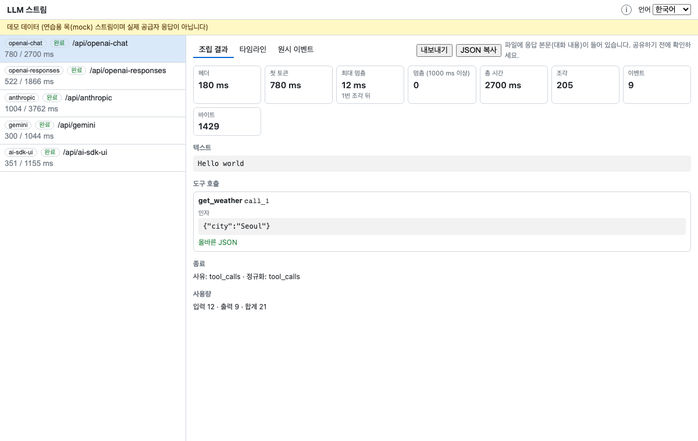
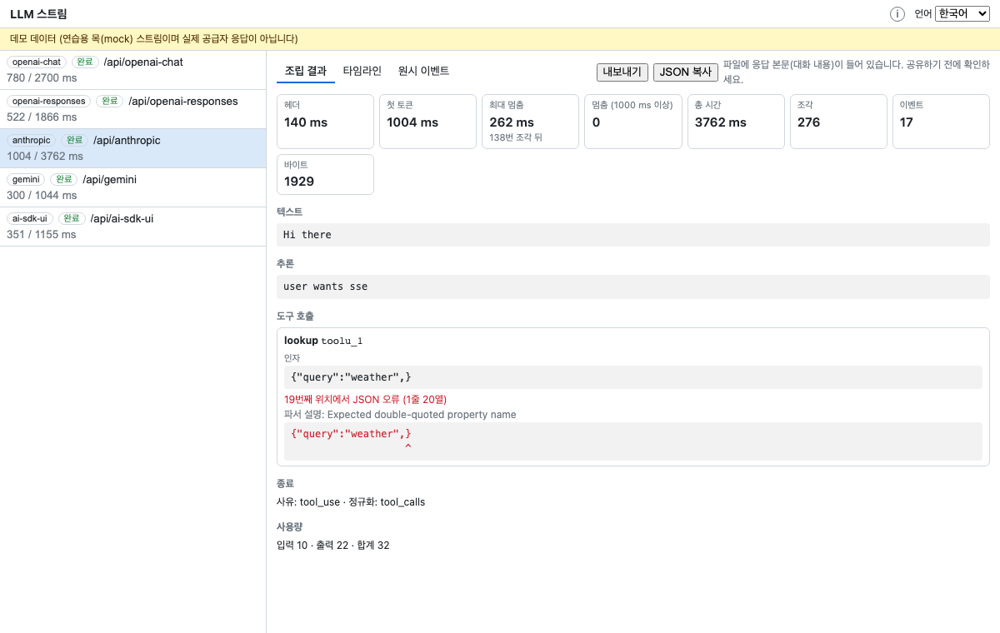
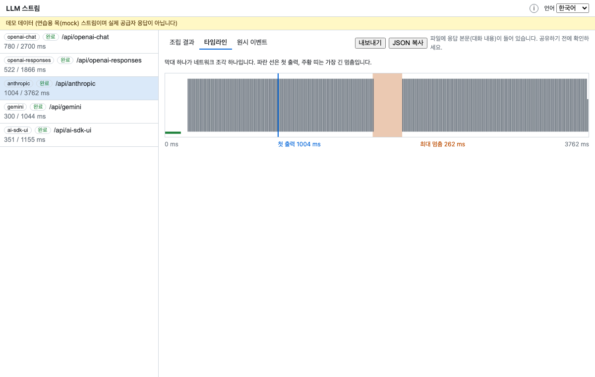
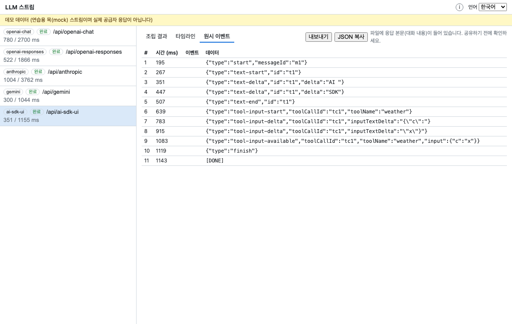
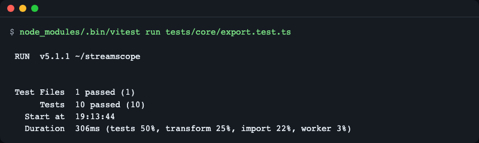
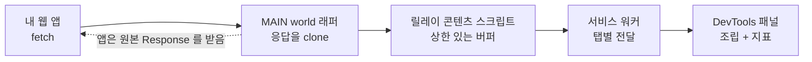

# streamscope

[English](README.md) | **한국어**

디버깅 중인 페이지의 스트리밍(SSE) `fetch()` 호출을 지켜보고 다시 조립해 보여 주는 Chrome DevTools 패널("LLM Streams")입니다. 최종 텍스트, 추론, 도구 호출 인자(깨진 JSON 은 정확한 위치까지), 지연 시간 지표, 다시 재생할 수 있는 내보내기 파일을 보여 줍니다. OpenAI, Anthropic, Gemini, Vercel AI SDK 스트림을 지원하며 앱 코드를 고칠 필요가 없습니다.


*내장 데모 데이터로 본 패널: 왼쪽은 요청 목록, 오른쪽은 조립 결과. 이 데모 데이터로 패널을 미리 보려면 탭에서 `chrome-extension://<확장-id>/panel/panel.html?demo=1` 을 여세요(id 는 `chrome://extensions` 에 표시됩니다).*

## 무엇을 더해 주나요

- **조립 결과**: 원시 이벤트에서 텍스트·추론·도구 호출·종료 사유·사용량·중간 오류를 다시 만들어 줍니다. 도구 인자는 JSON 으로 검사하고, 실패하면 위치·줄·열을 보여 줍니다.
- **타임라인과 지표**: 헤더까지 걸린 시간, 첫 출력까지의 시간(TTFT), 최대 멈춤, 멈춤 횟수, 총 시간, 조각·바이트 수.
- **원시 이벤트**: 파싱한 모든 이벤트와 도착 시간.
- **내보내기**: 조각과 시간 정보가 담긴 `streamscope/v1` JSON 파일과, 내 테스트에서 재생하는 작은 도우미.
- 영어·한국어 화면과 언어 메뉴.

## 언제 쓰나

잘 맞는 경우:

- `fetch()` 로 모델 출력을 스트리밍하는 웹 앱을 디버깅하며, 앱을 고치지 않고 조립 결과, 깨진 도구 인자 JSON, 멈춤 시간, 재생 가능한 픽스처가 필요할 때.

다른 도구가 더 맞을 수 있습니다(이름과 링크만 적습니다. 지금 하는 일은 각 페이지에서 확인하세요, 2026-11-18 기준):

- 단순한 이벤트 목록이면 브라우저 기본 DevTools 의 EventStream 탭.
- 범용 SSE 뷰어: [StreamPanel](https://github.com/bywwcnll/StreamPanel), Chrome 웹 스토어의 "SSE Viewer" 확장.
- 앱이 Vercel AI SDK 기반이라면 [AI SDK Tools](https://github.com/midday-ai/ai-sdk-tools).
- 이미 텍스트로 복사해 둔 스트림이라면 붙여넣기형 파서 [puredevtools SSE parser](https://puredevtools.pages.dev/sse-stream-parser/).

## 요구 사항

| 항목 | 버전 | 비고 |
|---|---|---|
| Chrome / Chromium | 120 이상 | Manifest V3(`minimum_chrome_version` 120). 작성자의 자동 점검에서는 실제 브라우저에 로드해 보지 못했습니다. [한계](#한계) 참고. |
| Node.js | `^22.22.2`, `^24.15.0`, `>=26` | 빌드·테스트에만 필요. Node 26.13.0 에서 확인. |
| npm | Node 에 포함 | |

Node.js 는 평소 쓰는 방법으로 설치하세요. 예: `brew install node`(macOS), `nvm install --lts`. 최소 리눅스 이미지에는 `git`, `ca-certificates` 도 필요합니다.

## 설치

```bash
git clone https://github.com/LeeGyeongPil/streamscope.git
cd streamscope
npm install
npm run build
```

`npm run build` 가 끝나면 확장이 `dist/` 에 만들어집니다. Chrome 에서:

1. `chrome://extensions` 를 엽니다.
2. **개발자 모드**를 켭니다.
3. **압축해제된 확장 프로그램을 로드합니다**를 눌러 `dist/` 폴더를 고릅니다.

태그를 공개하면 GitHub 릴리스에 빌드된 `dist` zip 도 붙습니다.

## 빠르게 시작하기: 연습용 서버로 해 보기

```bash
npm start
```

확장을 빌드하고 로컬 연습용 서버를 띄웁니다. 실제 출력(한국어, `--lang ko` 또는 `STREAMSCOPE_LANG=ko`):

```text
streamscope 연습용 목(mock) 서버
연습용 목(mock): 공개 문서의 이벤트 형식을 흉내 낸 스트림이며 실제 공급자 응답이 아닙니다.
http://localhost:5179 에서 대기 중
확장 로드: chrome://extensions -> 개발자 모드 -> 압축해제된 확장 프로그램 로드 -> <repo>/dist
확장을 로드한 Chrome 에서 http://localhost:5179 을 열고 버튼을 눌러 보세요.
그다음 목 페이지에서 DevTools -> "LLM Streams" 패널을 여세요.
```

1. 위 방법으로 `dist/` 를 로드합니다(한 번만).
2. <http://localhost:5179> 를 열고 **Anthropic**(또는 다른 형식) 버튼을 누릅니다. 페이지의 옵션으로 줄 중간에서 조각 자르기, 멈춤 넣기, 도구 인자 깨뜨리기를 켤 수 있습니다.
3. F12 를 눌러 **LLM Streams** 탭을 엽니다. 확장을 설치하기 전에 연 페이지라면 새로고침하세요.

### 연습용 서버는 목(mock)입니다

실제 공급자가 아닌 연습용 목입니다:

- 지원하는 다섯 공급자의 공개 이벤트 형식을 흉내 내, 고정된 가짜 텍스트를 실제 로컬 HTTP 로 보냅니다. 실제 공급자를 호출하지 않고 API 키도 필요 없습니다.
- 페이지 옵션으로 조각 크기(바이트) 바꾸기, 250 ms 멈춤 넣기, 도구 인자 깨뜨리기(Anthropic), 연결 중간 끊기를 할 수 있습니다.
- 실제 서버는 속도, 조각 나누는 방식, 추가 필드, 오류 본문이 다릅니다. 목으로 패널 사용법을 익힌 뒤 내 앱에 패널을 써 보세요.

## 사용법

`fetch()` 로 모델 응답을 스트리밍하는 아무 페이지에서 DevTools 를 열고 **LLM Streams** 를 고르세요. 스트리밍 요청마다 한 줄이 생깁니다: 공급자, 상태, 경로, `첫 출력 / 총 시간`(ms).

### 조립 결과


*깨진 도구 호출: 인자와 오류 문구, 실패한 열을 가리키는 캐럿.*

연습용 페이지에서 "도구 인자 깨뜨리기" 옵션을 켜면(기본은 꺼짐) Anthropic 스트림의 도구 인자 끝에 쉼표가 남습니다(`{"query":"weather",}`). 패널은 19번째 위치, 1줄 20열이라고 알려 줍니다. 조각난 JSON 을 모두 합친 뒤에야 알 수 있는 정보라, 이벤트를 한 줄씩 나열하는 화면으로는 볼 수 없습니다.

### 타임라인


*막대 하나가 네트워크 조각 하나입니다. 파란 선은 첫 출력, 주황 띠는 가장 긴 멈춤입니다.*

| 지표 | 뜻 |
|---|---|
| 헤더 | 요청 시작부터 응답 헤더까지의 시간(서버 대기). |
| 첫 토큰(TTFT) | 첫 텍스트·추론·도구 인자 조각까지의 시간. 도구 인자만 있는 스트림은 첫 인자 조각 기준. |
| 최대 멈춤 | 두 조각 사이의 가장 긴 공백과 어느 조각 뒤인지. |
| 멈춤 | 멈춤 기준(기본 1000 ms) 이상인 공백의 수. |
| 총 시간 | 요청 시작부터 스트림 끝까지. |

헤더와 TTFT 를 나눠 보면 서버 대기와 모델 생성 지연을 구분할 수 있습니다.

### 원시 이벤트


*파싱한 모든 이벤트와, 그 이벤트를 끝낸 조각의 도착 시간.*

### 내보내기와 재생

**내보내기** 버튼은 `streamscope-<공급자>-<시각>.json` 을 내려받습니다(`JSON 복사` 는 클립보드로). 파일에 응답 본문(대화 내용)이 들어 있으니 공유 전에 확인하세요. 요청 헤더·본문은 저장하지 않습니다. 내보낸 `url` 에서는 비밀로 보이는 쿼리 인자(`key`, `api_key`, `access_token`, `token`, `sig`, `signature`, `secret`, `password`)의 값이 `***` 로 바뀌고, 요청 목록에서도 가려집니다. 계정을 식별하거나 비밀을 담는 응답 헤더(cookie, authorization, organization, project, account, token, API 키 헤더)는 빠집니다. 이름으로 거르는 방식이라 픽스처로 커밋하기 전에는 파일을 직접 읽어 보세요. 브라우저가 클립보드를 막으면 `JSON 복사` 가 "복사하지 못했습니다. 대신 내보내기를 사용하세요." 를 보여 주니 **내보내기**를 쓰세요.

`src/core/replay.ts`(의존성 없는 파일 하나)를 내 프로젝트에 복사하면 내보낸 파일을 다시 스트리밍 `Response` 로 만들 수 있습니다:

```ts
import { readFileSync } from "node:fs";
import { toResponse } from "./replay"; // 번들러나 TS 실행기(Vitest, tsx) 기준. 일반 Node 는 "./replay.ts"

// 패널의 내보내기 버튼으로 저장한 파일입니다(저장소에 예제 파일은 없습니다).
const exp = JSON.parse(readFileSync("fixtures/broken-tool-call.json", "utf8"));
const res = toResponse(exp, { speed: 0 }); // 1 은 기록된 간격 유지, 2 는 두 배 빠르게, 0 은 즉시
const body = await res.text();              // res 를 내 스트림 파서에 넘겨도 됩니다
```

저장소 자체 테스트가 다섯 형식의 왕복 재생을 확인합니다:


*`node_modules/.bin/vitest run tests/core/export.test.ts` (`npx vitest run ...` 과 같음)*

## 지원 형식

| 형식 | 판별 방법 |
|---|---|
| OpenAI Chat Completions(OpenAI 호환 서버 포함) | `choices` 배열 또는 `chat.completion.chunk` 데이터 |
| OpenAI Responses | 이벤트 `type` 이 `response.` 로 시작 |
| Anthropic Messages | `message_start`, `content_block_*` 이벤트 |
| Gemini `alt=sse` | 데이터의 `candidates` / `usageMetadata` |
| Vercel AI SDK UI 메시지 스트림 | `x-vercel-ai-ui-message-stream` 헤더 |

그 밖은 원시 이벤트를 남긴 채 `알 수 없음` 으로 표시합니다. 관찰하지 않는 것: `XMLHttpRequest`, `WebSocket`, Worker 안의 `fetch`, `EventSource`.

## 언어

패널, 확장 이름, 연습용 페이지, 연습용 서버의 터미널 출력이 영어와 한국어를 지원합니다.

- **패널**: 패널 상단의 언어 메뉴(`English` / `한국어`). 첫 실행은 브라우저 언어를 따르고, 고른 값은 확장 저장소에 저장됩니다. `panel.html?lang=ko` 는 저장 없이 덮어씁니다.
- **연습용 페이지**: `http://localhost:5179/?lang=ko`.
- **연습용 서버 터미널**: `--lang en|ko`, 다음 `STREAMSCOPE_LANG`, 다음 `LC_ALL`, `LC_MESSAGES`, `LANG`. 한국어가 아니면 영어입니다.

## 설정

| 이름 | 기본값 | 설명 |
|---|---|---|
| 언어 메뉴(패널 상단) | 첫 실행은 브라우저 언어 | [언어](#언어) 참고. |
| `STREAMSCOPE_PORT` | `5179` | 연습용 서버 포트(`--port` 도 가능). |
| `STREAMSCOPE_LANG` | 빈 값 | 연습용 서버 터미널 언어 `en` 또는 `ko`. `--lang` 이 우선, 다음 `LC_ALL`, `LC_MESSAGES`, `LANG`. 한국어가 아니면 영어. |

`.env.example` 참고. 확장 자체에는 설정할 것이 없습니다.

## 동작 원리



1. 페이지와 같은 JavaScript 세계에서 도는 콘텐츠 스크립트가 `window.fetch` 를 감쌉니다. `text/event-stream` 응답은 **clone** 을 읽으므로 앱은 원본 `Response` 를 그대로 받습니다.
2. 두 번째 콘텐츠 스크립트가 조각을 16 ms 단위로 묶어 확장으로 넘깁니다. 탭당 최대 50개 요청, 요청마다 5 MB 또는 20,000 조각까지만 보관하고 상한에 닿으면 잘림으로 표시합니다.
3. 서비스 워커는 상태가 없고, 같은 탭의 패널로 조각을 전달하며 패널이 열릴 때 밀린 조각을 다시 보냅니다. Chrome 이 유휴 워커를 멈추면 패널에 "확장과 다시 연결하는 중..." 이 뜨며 다시 연결하고, 페이지 쪽 버퍼로 캡처를 복구합니다.
4. 패널이 SSE 를 파싱하고 공급자를 판별해 결과를 조립하고 지표를 계산합니다. 네트워크로 보내는 것은 없습니다.

### 개인정보와 권한

- 어떤 사이트든 모델 응답을 스트리밍할 수 있어서 콘텐츠 스크립트는 `<all_urls>` 에 맞춰 둡니다. `text/event-stream` 응답의 헤더와 본문만 메모리에서 읽습니다.
- 요청 헤더·본문(API 키, 프롬프트)은 읽지 않습니다. 브라우저 밖으로 나가는 것은 없습니다.
- 요청 URL 은 어떤 호출인지 알려 주므로 캡처합니다. 비밀로 보이는 쿼리 값은 목록과 내보내기에서 `***` 로 가려집니다([내보내기와 재생](#내보내기와-재생) 참고).
- 확장 권한은 `storage`(언어 선택 저장) 하나뿐입니다.

## 자주 겪는 문제

| 증상 | 원인 | 해결 |
|---|---|---|
| 패널에 "아직 스트리밍 요청이 없습니다" | 확장을 설치하기 전에 페이지를 열었거나 다른 탭의 DevTools 를 열었음 | 확장을 켠 상태로 페이지를 새로고침한 뒤 요청을 다시 실행. |
| 요청이 안 보임 | `XMLHttpRequest`, `WebSocket`, `EventSource`, Worker 를 쓰거나 응답이 `text/event-stream` 이 아님 | 관찰하지 않는 경로입니다([한계](#한계) 참고). |
| 공급자가 `알 수 없음` | 다섯 형식이 아님 | 원시 이벤트 탭을 보고, 내보내기 파일과 함께 이슈를 남겨 주세요. |
| `npm start` 가 `dist/` 가 없다고 경고 | 빌드가 끝나지 않음 | `npm run build` 를 실행해 오류를 확인. |
| 5179 포트 사용 중 | 다른 프로세스가 사용 | `STREAMSCOPE_PORT=5180 npm run mock` |

## 개발·기여

```bash
npm install
npm run typecheck   # tsc --noEmit
npm test            # 파일 14개, 테스트 111개 (Vitest + jsdom)
npm run build       # 패널, devtools 페이지, 서비스 워커, 콘텐츠 스크립트 번들 2개
npm run check:dist  # "dist OK" 출력
npx playwright install chromium   # e2e 전에 한 번
npm run test:e2e    # 실제 Chromium, 화면 필요(화면 없는 리눅스: xvfb-run -a npm run test:e2e), CI 에서도 실행
```

`npm test` 출력:

```text
 Test Files  14 passed (14)
      Tests  111 passed (111)
```

### 한계

- 로컬 개발 중에는 확장을 실제 브라우저에 로드해 보지 못했고, 브라우저 종단 점검은 CI 에서만 돕니다. 패널 동작은 jsdom 테스트로 확인했습니다.
- 캡처는 모든 사이트에서 항상 켜져 있습니다. 페이지 쪽 스크립트가 스트리밍 응답을 모두 버퍼에 담고(요청당 5 MB 또는 20,000 조각, 탭당 50개) DevTools 가 닫혀 있어도 묶음을 확장으로 보내므로 서비스 워커가 깨어날 수 있습니다. 사이트별 켜기/끄기는 계획만 있고 만들지 않았습니다.
- **지우기**는 패널만 비웁니다. 다시 연결되면 페이지 쪽 버퍼가 지운 요청을 되살릴 수 있으니, 깨끗이 시작하려면 페이지를 새로고침하세요.
- `npm audit` 가 개발·빌드 도구(vite, vitest 를 거치는 picomatch)에서 높음 등급 항목을 보고합니다. `dist/` 에는 들어 있지 않고, 2026-11-18 에는 패치된 picomatch 릴리스가 없어 그대로 남아 있습니다.
- 확장이 감싼 뒤 코드가 `window.fetch` 를 다시 덮어쓰면 패널에서 요청이 가려질 수 있습니다.
- 계획만 있고 만들지 않은 것: DevTools 를 열기 전 요청을 네트워크 API 로 가져오기, HAR 가져오기, Gemini JSON 배열·NDJSON 스트림, 사이트별 켜기/끄기, Firefox.

변경 기록은 [CHANGELOG.md](CHANGELOG.md).

## 라이선스

MIT.
