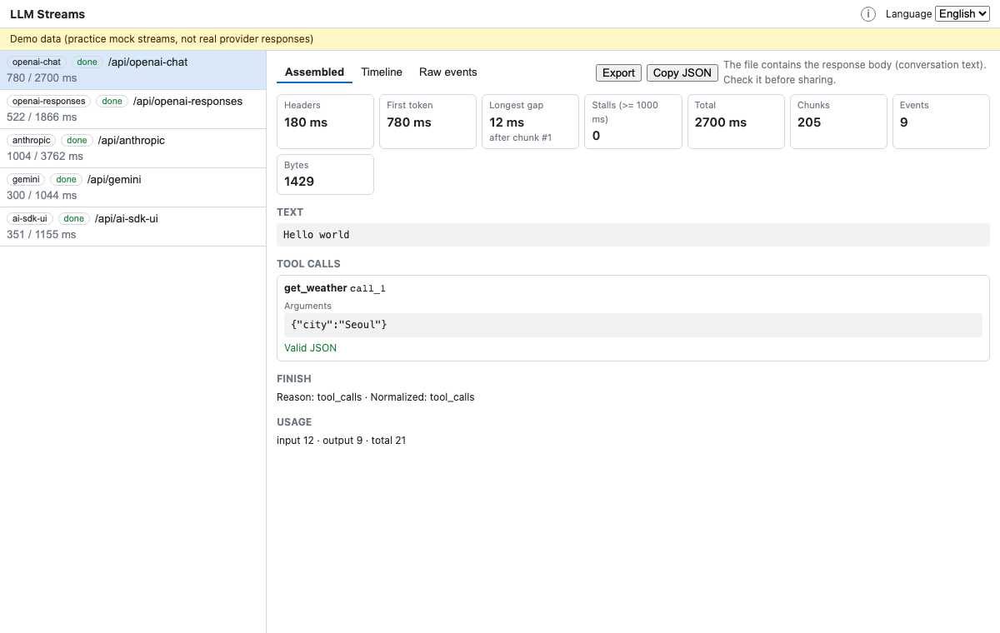
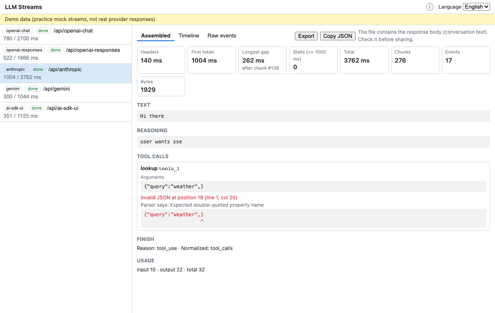
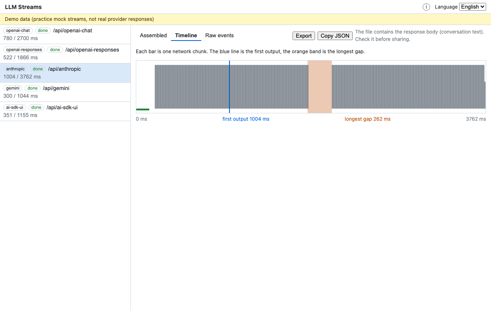
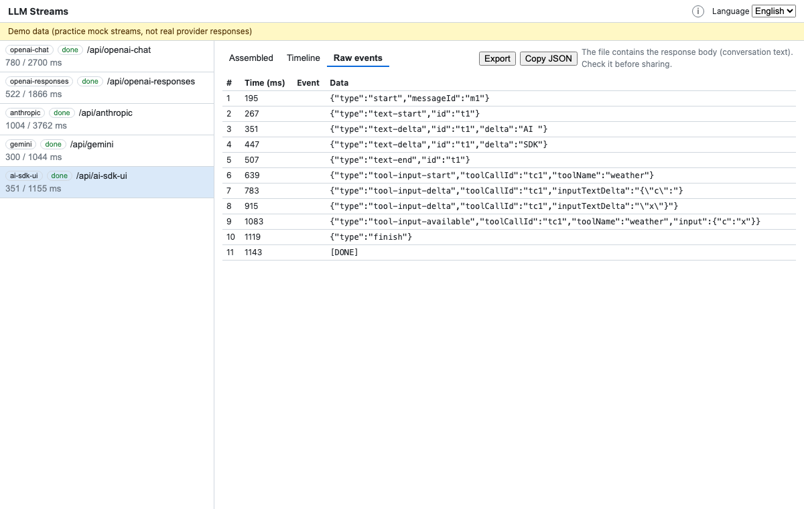
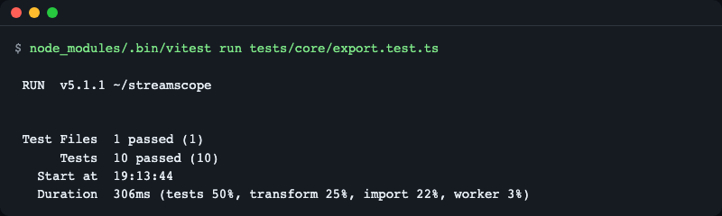
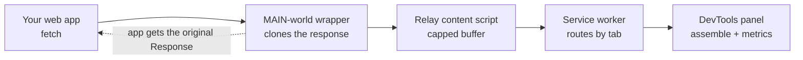

# streamscope

**English** | [한국어](README.ko.md)

A Chrome DevTools panel ("LLM Streams") that watches the streaming (SSE) `fetch()` calls of the page you are debugging and reassembles them: final text, reasoning, tool-call arguments (with the exact position of broken JSON), latency numbers, and a replayable export. It works with OpenAI, Anthropic, Gemini and Vercel AI SDK streams and needs no changes to your app code.


*The panel on built-in demo data: requests on the left, the assembled result on the right. To preview the panel with this demo data, open `chrome-extension://<extension-id>/panel/panel.html?demo=1` in a tab (the id is shown on `chrome://extensions`).*

## What it adds

- **Assembled view**: text, reasoning, tool calls, finish reason, usage and mid-stream errors rebuilt from the raw events. Tool arguments are checked as JSON and a failure shows the position, line and column.
- **Timeline and metrics**: time to headers, time to first output (TTFT), longest gap, stalls, total time, chunk and byte counts.
- **Raw events**: every parsed event with its arrival time.
- **Export**: a `streamscope/v1` JSON file with the chunks and their timings, plus a small helper to replay it in your own tests.
- English and Korean UI with a language menu.

## When to use it

Good fit:

- You debug a web app that streams model output through `fetch()` and need the assembled result, broken tool-argument JSON, gap timings, or a replayable fixture, without changing the app.

Other tools may fit better (names and links only; check their pages for what they do today, as of 2026-11-18):

- The browser's built-in DevTools EventStream tab, for a plain list of events.
- General SSE viewers such as [StreamPanel](https://github.com/bywwcnll/StreamPanel) or the "SSE Viewer" extension on the Chrome Web Store.
- [AI SDK Tools](https://github.com/midday-ai/ai-sdk-tools), if your app is built on the Vercel AI SDK.
- Paste-in parsers such as [puredevtools SSE parser](https://puredevtools.pages.dev/sse-stream-parser/), for a stream you already copied as text.

## Requirements

| Item | Version | Notes |
|---|---|---|
| Chrome / Chromium | 120 or newer | Manifest V3 (`minimum_chrome_version` is 120). Not loaded in a real browser by the author's automated checks, see [Limitations](#limitations). |
| Node.js | `^22.22.2`, `^24.15.0` or `>=26` | Only to build and test. Checked with Node 26.13.0. |
| npm | bundled with Node | |

Install Node.js with your usual tool, for example `brew install node` (macOS) or `nvm install --lts`. On a minimal Linux image you also need `git` and `ca-certificates`.

## Install

```bash
git clone https://github.com/LeeGyeongPil/streamscope.git
cd streamscope
npm install
npm run build
```

`npm run build` ends by writing the extension into `dist/`. Then in Chrome:

1. Open `chrome://extensions`.
2. Turn on **Developer mode**.
3. Click **Load unpacked** and pick the `dist/` folder.

A prebuilt `dist` zip is attached to GitHub releases once a tag is published.

## Quick start: try it on the practice server

```bash
npm start
```

This builds the extension and starts a local practice server. Real output (English):

```text
streamscope practice mock server
Practice mock: these streams imitate public event formats, they are not real provider responses.
Listening on http://localhost:5179
Load the extension: chrome://extensions -> Developer mode -> Load unpacked -> <repo>/dist
Open http://localhost:5179 in Chrome (with the extension loaded) and press a button.
Then open DevTools -> "LLM Streams" on the mock page.
```

1. Load `dist/` as shown above (once).
2. Open <http://localhost:5179> and press **Anthropic** (or any format button). Options on the page let you cut chunks in the middle of a line, add a stall, or break the tool arguments.
3. Press F12, open the **LLM Streams** tab. Reload the page if the extension was installed after it was opened.

### The practice server is a mock

It is a practice mock, not a real provider:

- It imitates the public event formats of the five supported providers and sends fixed, made-up text over real local HTTP. It never calls a real provider and needs no API key.
- The page options change chunk size (bytes), add a 250 ms pause, break the tool arguments (Anthropic) or cut the connection halfway.
- A real server differs in speed, chunking, extra fields and error bodies. Treat the mock as a way to learn the panel, then point the panel at your own app.

## Usage

Open DevTools on any page that streams a model response with `fetch()` and choose **LLM Streams**. Each streaming request becomes a row: provider, status, path, and `first output / total` in ms.

### Assembled


*A broken tool call: the arguments are shown with an error and a caret at the failing column.*

With the "break the tool arguments" option ticked on the practice page (it is off by default), the Anthropic stream ends its tool arguments with a trailing comma (`{"query":"weather",}`). The panel reports position 19, line 1, column 20. You only learn this after joining all the partial JSON pieces, which a line-by-line event list cannot show.

### Timeline


*Each bar is one network chunk. The blue line is the first output, the orange band the longest gap.*

| Metric | Meaning |
|---|---|
| Headers | Time from request start to response headers (server queueing). |
| First token (TTFT) | Time to the first text, reasoning or tool-argument chunk. For a stream with only tool arguments, the first arguments chunk counts. |
| Longest gap | Biggest pause between two chunks and which chunk it follows. |
| Stalls | Number of gaps at or above the stall threshold (default 1000 ms). |
| Total | Time from request start to the end of the stream. |

Separating headers from TTFT tells server waiting apart from model generation delay.

### Raw events


*Every parsed event with the time of the chunk that completed it.*

### Export and replay

The **Export** button downloads `streamscope-<provider>-<timestamp>.json` (`Copy JSON` copies it). The file holds the response body (conversation text), so check it before sharing. Request headers and bodies are never stored. In the exported `url`, values of secret-looking query parameters (`key`, `api_key`, `access_token`, `token`, `sig`, `signature`, `secret`, `password`) are replaced with `***`; the request list masks them too. Response headers that identify an account or carry secrets (cookie, authorization, organization, project, account, token, API-key headers) are left out. This is name-based, so still read the file before you commit it as a fixture. If the browser blocks the clipboard, `Copy JSON` shows "Copy failed. Use Export instead."; use **Export**.

Copy `src/core/replay.ts` (one file, no dependencies) into your project and turn an export back into a streaming `Response`:

```ts
import { readFileSync } from "node:fs";
import { toResponse } from "./replay"; // bundler or TS runner (Vitest, tsx); plain Node needs "./replay.ts"

// An export you saved with the panel's Export button (the repository ships no sample file).
const exp = JSON.parse(readFileSync("fixtures/broken-tool-call.json", "utf8"));
const res = toResponse(exp, { speed: 0 }); // 1 keeps recorded gaps, 2 is twice as fast, 0 is instant
const body = await res.text();              // feed res to your own stream parser instead
```

The repository's own tests check the round trip for all five formats:


*`node_modules/.bin/vitest run tests/core/export.test.ts` (the same as `npx vitest run ...`)*

## Supported formats

| Format | How it is recognised |
|---|---|
| OpenAI Chat Completions (and OpenAI-compatible servers) | `choices` array or `chat.completion.chunk` data |
| OpenAI Responses | event `type` starts with `response.` |
| Anthropic Messages | `message_start`, `content_block_*` events |
| Gemini `alt=sse` | `candidates` / `usageMetadata` in data |
| Vercel AI SDK UI message stream | `x-vercel-ai-ui-message-stream` header |

Anything else is shown as `unknown` with the raw events kept. Not observed: `XMLHttpRequest`, `WebSocket`, `fetch` inside Workers and `EventSource`.

## Language

The panel, the extension name, the practice page and the practice server's terminal output come in English and Korean.

- **Panel**: the language menu in the panel header (`English` / `한국어`). The first run follows the browser language; your choice is saved in extension storage. `panel.html?lang=ko` overrides it without saving.
- **Practice page**: `http://localhost:5179/?lang=ko`.
- **Practice server terminal**: `--lang en|ko`, then `STREAMSCOPE_LANG`, then `LC_ALL`, `LC_MESSAGES`, `LANG`. Anything that is not Korean means English.

## Settings

| Name | Default | Description |
|---|---|---|
| Language menu (panel header) | browser language on first run | See [Language](#language). |
| `STREAMSCOPE_PORT` | `5179` | Port of the practice server (or `--port`). |
| `STREAMSCOPE_LANG` | empty | Practice server terminal language `en` or `ko`. `--lang` wins, then `LC_ALL`, `LC_MESSAGES`, `LANG`; anything not Korean means English. |

See `.env.example`. There is nothing to configure for the extension itself.

## How it works



1. A content script in the page's own JavaScript world wraps `window.fetch`. For `text/event-stream` responses it reads a **clone**, so the app receives its original `Response` untouched.
2. A second content script relays the chunks (batched every 16 ms) to the extension. It keeps at most 50 requests per tab, each capped at 5 MB or 20,000 chunks, and marks a capture as truncated when the cap is hit.
3. The service worker is stateless and forwards chunks to the panel of the same tab, replaying the backlog when the panel opens. Chrome stops an idle worker; the panel then shows "Reconnecting to the extension..." and reconnects, and the page-side buffer restores the captures.
4. The panel parses SSE, detects the provider, assembles the result and computes the metrics. Nothing is sent over the network.

### Privacy and permissions

- The content scripts match `<all_urls>` because any site might stream a model response. They only read headers and bodies of `text/event-stream` responses, in memory.
- Request headers and bodies (API keys, prompts) are never read. Nothing leaves your browser.
- The request URL is captured, because it identifies the call. Secret-looking query values are masked as `***` in the list and in exports (see [Export and replay](#export-and-replay)).
- The only extension permission is `storage` (language choice).

## Troubleshooting

| Symptom | Cause | Fix |
|---|---|---|
| Panel says "No streaming requests yet" | The page was loaded before the extension was installed, or DevTools was opened on another tab | Reload the page with the extension enabled, then trigger the request. |
| A request never shows up | It uses `XMLHttpRequest`, `WebSocket`, `EventSource` or a Worker, or the response is not `text/event-stream` | Not observed (see [Limitations](#limitations)). |
| Provider shows `unknown` | The format is not one of the five | Use Raw events; open an issue with an export. |
| `npm start` warns that `dist/` is missing | The build did not finish | Run `npm run build` and look for errors. |
| Port 5179 is busy | Another process uses it | `STREAMSCOPE_PORT=5180 npm run mock` |

## Development

```bash
npm install
npm run typecheck   # tsc --noEmit
npm test            # 14 files, 111 tests (Vitest + jsdom)
npm run build       # panel, devtools page, service worker, then two content-script bundles
npm run check:dist  # prints "dist OK"
npx playwright install chromium   # once, before the e2e test
npm run test:e2e    # real Chromium, needs a display (on headless Linux: xvfb-run -a npm run test:e2e); also run in CI
```

Output of `npm test`:

```text
 Test Files  14 passed (14)
      Tests  111 passed (111)
```

### Limitations

- The extension has not been loaded in a real browser during local development; the browser end-to-end check runs only in CI. Panel behaviour is covered by jsdom tests.
- Capture is always on, on every site: the page-side script buffers each streaming response (up to 5 MB or 20,000 chunks per request, 50 requests per tab) and sends batches to the extension even when DevTools is closed, which can wake the service worker. A per-site switch is planned, not built.
- **Clear** empties only the panel. After a reconnect, the page-side buffer can bring cleared requests back; reload the page to start clean.
- `npm audit` reports high-severity findings in development and build tools (picomatch, via vite and vitest). They are not in `dist/`; no patched picomatch release existed on 2026-11-18, so they remain.
- Code that replaces `window.fetch` again after the extension wrapped it can hide requests from the panel.
- Planned, not built: capturing requests made before DevTools opened via the network API, HAR import, Gemini JSON-array and NDJSON streams, per-site toggle, Firefox.

Changes are listed in [CHANGELOG.md](CHANGELOG.md).

## License

MIT.
